# Ayu — a daily health check for pregnancy and new mothers

An installable web app (PWA) in nine Indian languages. Every day Ayu asks a pregnant woman or new mother a few questions she can answer with a tap, or she tells Ayu in her own words, and Ayu says what to do next: **all fine**, **talk to your ASHA**, **see a doctor today** or **call 108**. Her ASHA has a companion app on the same data: who needs me first, what to check, and which questions her women get.

**Fixed rules decide the level, never the AI.** A question set, an ASHA's edit or the model can raise a level and can never lower one.

> **Not a medical device.** The rules and wording have not been clinically reviewed. The non-English text is a draft for native review. Do not use for care without that review.

**Live:** https://ayu-daily-talk-web.vercel.app

| Home | Daily check | See a doctor today | Call 108 | Help now |
|---|---|---|---|---|
| 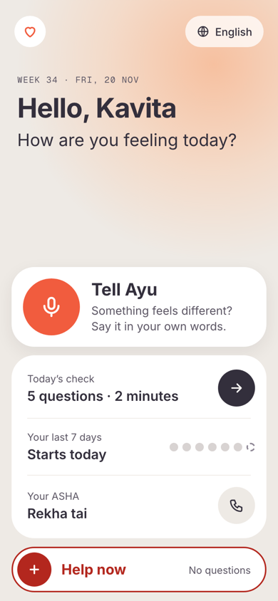 | 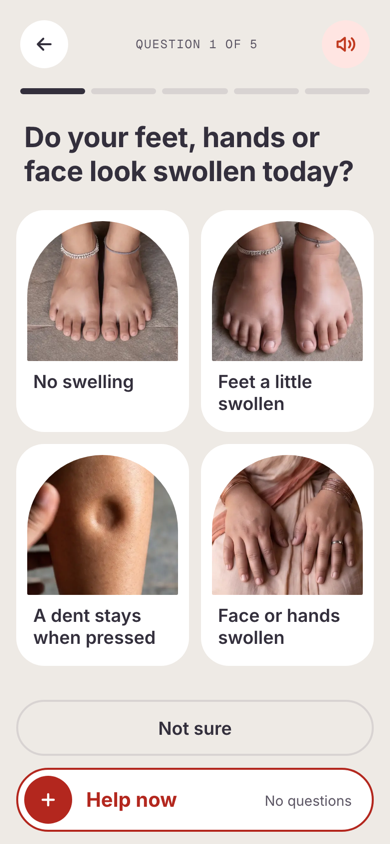 | 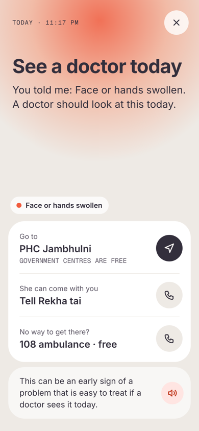 | 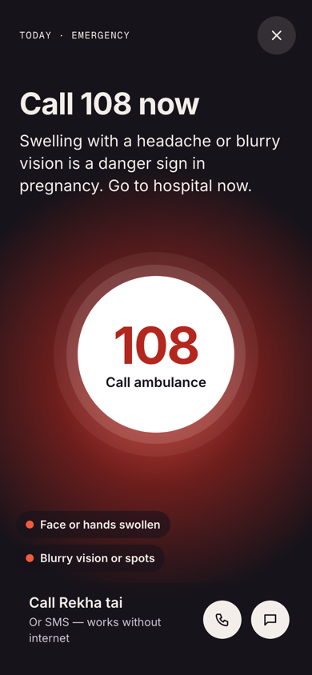 | 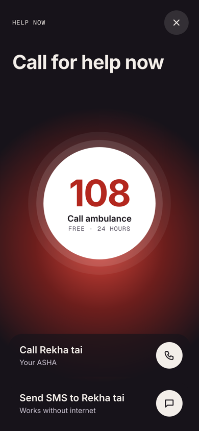 |
| **Tell Ayu (live)** | **Tell Ayu, camera on** | **Tell Ayu in Hindi** | **ASHA · Today** | **ASHA · one woman** |
| 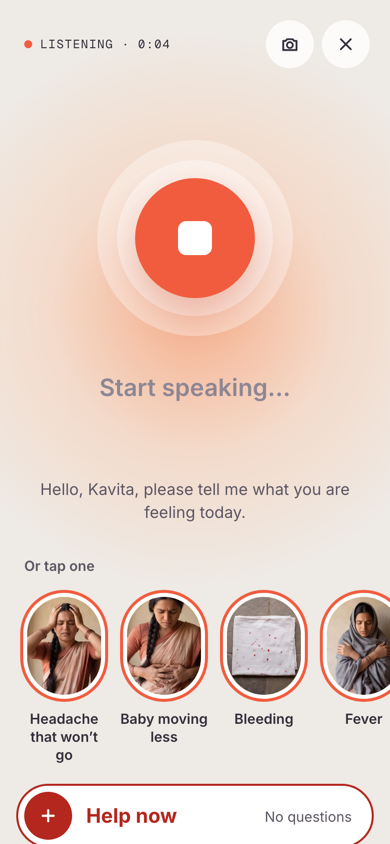 | 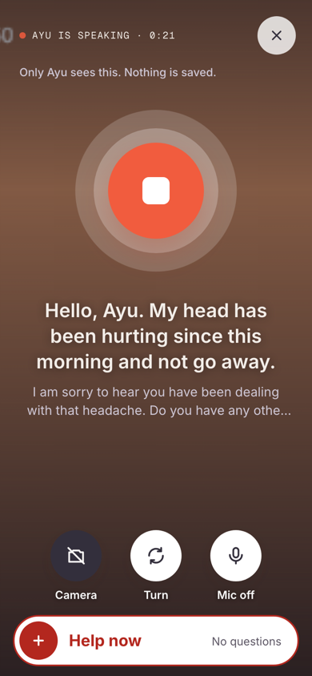 | 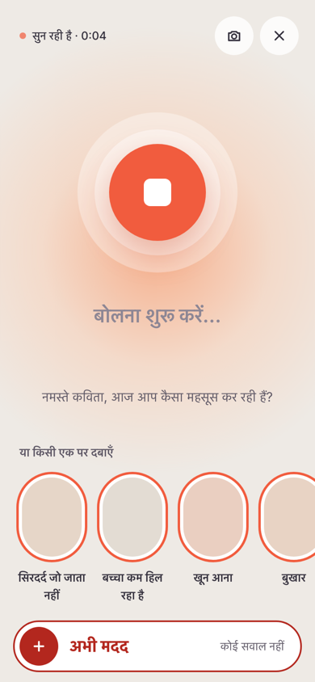 | 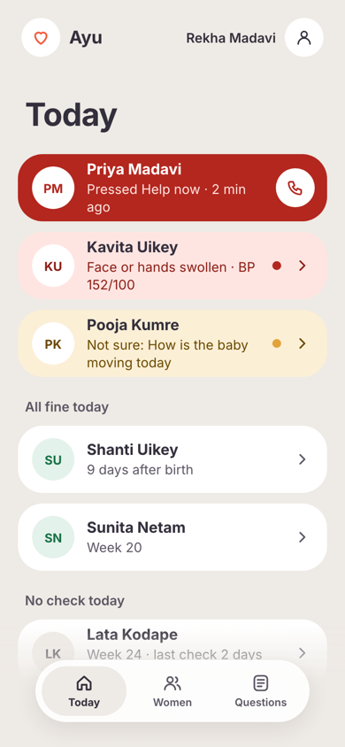 | 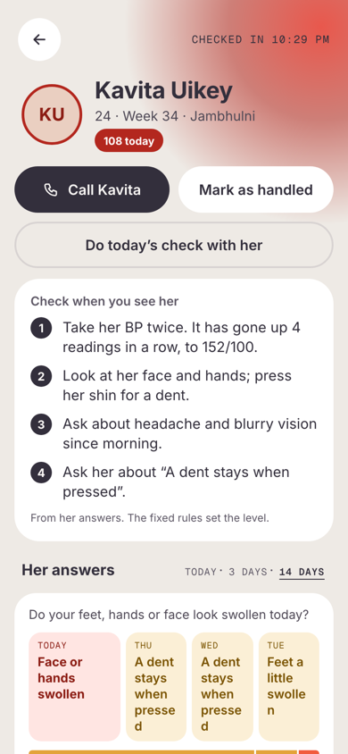 |
| **ASHA · Help alert** | **Questions** | **Review a draft** | **Approve and send** | **Result in Hindi** |
| 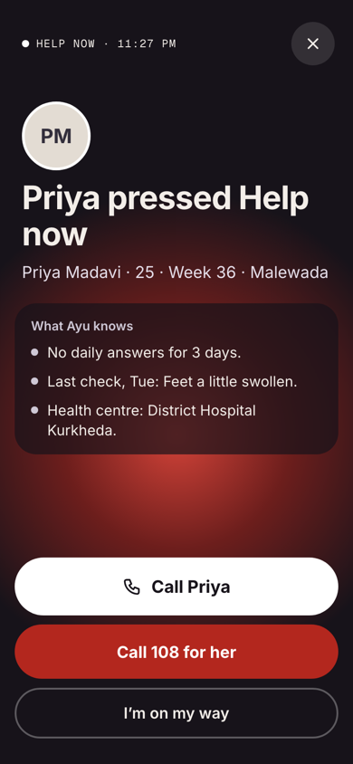 | 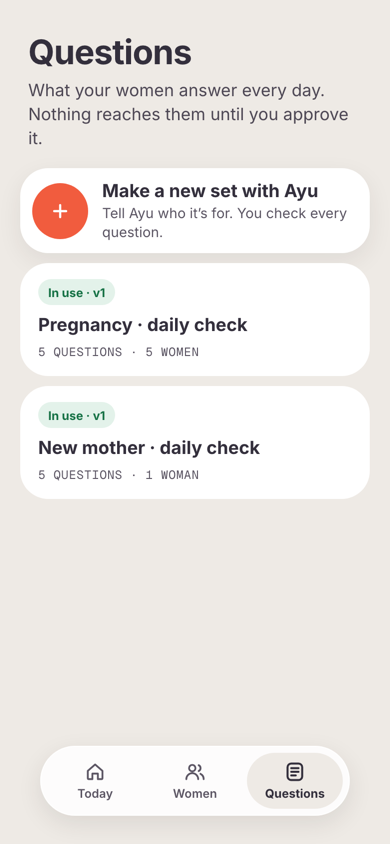 | 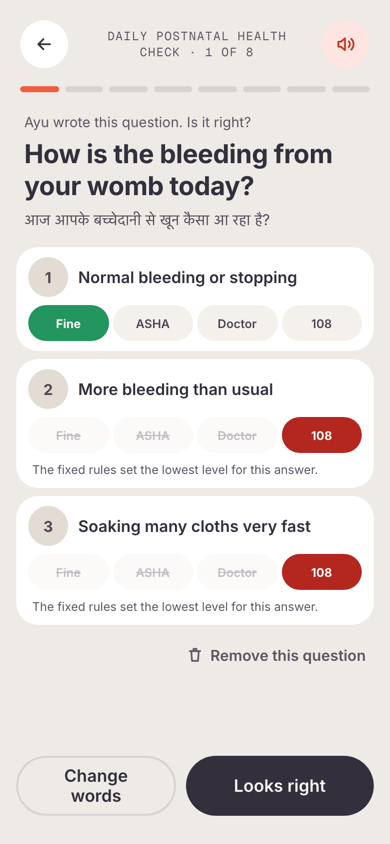 | 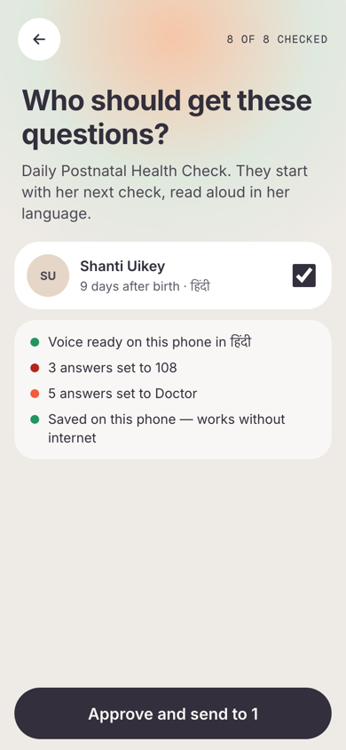 | 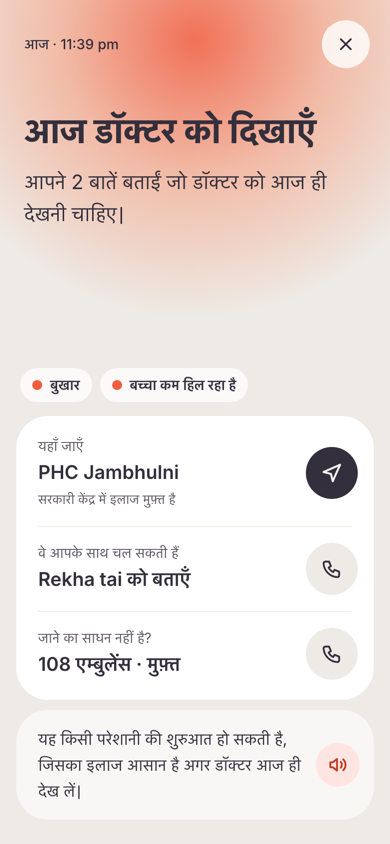 |

The names in the screenshots are test entries typed for the pictures. The app ships with no people, no sample answers and no scripted conversations.

## What it does

### Her app

- **Home.** One light (the aura) shows how today is before she reads a word: warm sand when fine, amber, orange, and a dark room with a red light for 108. Three quiet rows: today's check, her last 7 days, her ASHA's number.
- **Today's check.** It starts as a Gemini Live video call (route `/call`). Ayu greets her, then asks each question aloud while the app shows it as a card with the picture answers over the call. She taps an answer or says it (`record_answer`). "Not sure" is always there and is never treated as "no"; Ayu may then ask her to show it on the camera. Ayu never says the level. If she mentions something else, Ayu notes it and she confirms it on "You said". If the call ends with questions unanswered, the app continues the same check by tapping (`/check`) from the first open question. If there is no call (no mic, no internet, no key), a button offers the same check by tapping. The fixed rules decide the level, as before. Picture answers for every question of the pregnancy check.
- **Result.** What to do, why (the answers that raised the level), where to go (her health centre, with directions), her ASHA by call or SMS, and 108.
- **Tell Ayu — a live voice and video call.** She talks with Ayu in her own language over the Gemini Live API, like a call on the phone: Ayu greets her, talks with her, asks the follow-ups a good health worker would, answers her questions in plain words, and she can interrupt at any time. A call dock gives camera on/off, switch camera and mic off; with the camera on, Ayu sees about one frame a second and says what it sees. While they talk Ayu notes the danger signs she clearly says. When the talk ends she sees her own words and what Ayu understood, removes anything wrong, and only then do the fixed rules give a level — Ayu never says how serious it is. With no network the quick taps still work.
- **Help now.** On every calm screen. No questions: 108 in the middle, call or SMS her ASHA below. The SMS works without internet.

### The ASHA's app

- **Today.** Women who pressed Help now first, then by level, then "all fine today", then those with no check today.
- **One woman.** Call her, mark as handled, do today's check with her on this phone. "Check when you see her" is built from her answers by fixed lines (no model writes it). Her answers over today / 3 days / 14 days, and BP at home with the fixed number rules.
- **Help alert.** What Ayu knows (last check, days without answers, last BP, health centre), call her, call 108 for her, "I'm on my way".
- **Questions.** The ASHA tells Ayu who a set is for; Gemini drafts it in English and her women's languages. Nothing reaches a woman until the ASHA has checked every question and the level of every answer, and approved it. An answer that names a danger sign cannot be set below what the fixed rule says.

### Where the data lives

Everything the app needs is saved **on the phone** (browser storage): names, answers, question sets. There are no accounts and no app server database. Sign-in is a name and a phone number, not verified. The woman's app and the ASHA's app on one phone read the same data, so today an ASHA sees the women she added on her own phone and the checks done on it. Because of that the app never says "your ASHA has been alerted": it gives her a call button and a ready-written SMS instead. Sharing between phones needs a server and is the next step (see [`docs/GAPS.md`](docs/GAPS.md)).

What leaves the phone:

- Her voice (and camera frames, if she turns the camera on) go to Google's Gemini Live API during Tell Ayu and the daily check call.
- An ASHA's one-line description goes to Gemini when she asks for a draft set.
- **A research record of every talk and check** goes to a Firestore database in the Firebase project `ayu-daily-talk-research`, so Ayu can be improved. It has no name, phone number, village or ASHA details; it holds the transcription text, answers, signs, level and rule, not her voice. Records that cannot be sent wait on the phone and go the next time the app opens. Without the `VITE_FIREBASE_*` vars nothing is sent. What is sent, how to export or delete it, and the limits: [`docs/RESEARCH-DATA.md`](docs/RESEARCH-DATA.md).

## Run it

Needs Node 22+ and [pnpm](https://pnpm.io).

```bash
pnpm i && pnpm dev
```

- Web app: http://localhost:5173 · API: http://localhost:8787
- Tell Ayu and question drafts need `GEMINI_API_KEY` in `.env` (`cp .env.example .env`, key from [Google AI Studio](https://aistudio.google.com/apikey)). Without it the daily check, results, Help now and the whole ASHA triage still work; Tell Ayu says it cannot listen and offers the quick taps, and drafting says it needs the internet. Nothing is faked.
- If Vite moves to another port, add that origin to `ALLOWED_ORIGINS`.

Other scripts: `pnpm test`, `pnpm lint`, `pnpm build`, `pnpm start` (serve `dist/` + API), `pnpm scan` (gitleaks).

Install on a phone: Android Chrome → ⋮ → *Install app*; iPhone Safari → Share → *Add to Home Screen*. The app shell, the daily check and its rules work offline.

## Safety rules in code

| | |
|---|---|
| [`shared/red-flags.js`](shared/red-flags.js) | Fixed danger-sign rules by stage (pregnant, after birth, newborn). Follows the danger signs on India's MCP card. |
| [`shared/measurements.js`](shared/measurements.js) | Fixed number rules with their sources: BP 140/90 → doctor today, 160/110 → 108; 130/80 deliberately does not fire. See [`docs/MEASUREMENTS.md`](docs/MEASUREMENTS.md). |
| [`shared/question-sets.js`](shared/question-sets.js) | The built-in pregnancy and new-mother checks, and the cleaner every model-written draft passes through. |
| [`shared/triage.js`](shared/triage.js) | Combines them. Answer floors and set combinations can only raise the level. Anything she tells Ayu is never "all fine". |
| [`shared/journal.js`](shared/journal.js) | Week of pregnancy, last 7 days, the ASHA's ordering. |

- The model never decides or announces a level. In Tell Ayu it only transcribes and records signs; she confirms them; the rules run in the app.
- The model is told never to diagnose, never to name or change a medicine, and never to add odds or disclaimers.
- A draft question set is cleaned on the server and again on the phone, starts unchecked and unapproved, and its levels are clamped to the fixed rules.

The built-in pregnancy check follows the designer's board and raises five things above the older rule set; each is listed for clinical review in [`docs/GAPS.md`](docs/GAPS.md).

## Gemini

| | |
|---|---|
| Tell Ayu and the daily check call | Gemini Live, `gemini-3.8-live` (`GEMINI_LIVE_MODEL`), API `v1beta`. Mic in 16 kHz PCM, audio out 24 kHz, camera JPEG ≤ 1 frame/s, input and output transcription. A call ends by itself at 5 minutes (nudge at 4:30). |
| Draft sets | `gemini-flash-lite-latest` (`DRAFT_MODEL`), JSON output. |

**The key never reaches the phone.** The browser asks the server for a one-use ephemeral token (`POST /api/live-token`), valid for one session started within 60 s, with the model, system prompt and tools locked into the token. Her profile (name, stage, week, village) is cleaned on the server before it enters the prompt. POSTs need a browser `Origin` on the allow-list and the 10-minute page pass from `/api/health`; both endpoints are rate-limited per IP and capped per day.

Checked on 20–21 Nov 2026 in headless Chrome with recorded speech as the microphone, against the real API: English and Hindi sessions → greeting by name → live transcript → `record_symptom` → Ayu ends the talk → "You said" → fixed rules → result; a multi-turn English call with the camera on (Ayu described the picture, asked follow-ups, did not record the bleeding she denied, ended the call itself → see a doctor today); and a real draft set → review → approve → sent. Four of five English runs were clean; one lost her opening words (details and what was not checked: [`docs/GAPS.md`](docs/GAPS.md)). The daily check on the call (21 Nov) is unit-tested (`test/check-call.test.js`) but has not been run live yet; Om's phone test will be added to [`docs/GAPS.md`](docs/GAPS.md).

## Design

Screens follow Vrindar's boards "Ayu · patient app v0 — calm surfaces, one living light" and "Ayu · ASHA app v0 — triage first, then the detail", and the Ayu design rules (one left edge, one primary action, big targets low on the screen, every control does something, no emoji). Screens the boards do not show (first open, sign-up, profile, the Women tab, add a woman, the camera state of Tell Ayu) are built from the same pieces and marked `[Inferred]` in the code.

- Tokens and shared classes: [`src/styles.css`](src/styles.css); pieces: [`src/ui/`](src/ui).
- Fonts: Inter and Geist Mono, one variable woff2 each (Latin subset). Indian scripts use the phone's own font; the small uppercase labels become plain text there, because those scripts have no capitals.
- Languages: English ships with the app; each other language is fetched when first chosen. `pnpm test` fails if any language is missing a key or a placeholder.

## Project layout

```
shared/        rules and facts, used by server, browser and tests
src/patient/   first open, sign-up, Home, daily check (by tapping), result, Help now, profile
src/tell/      Tell Ayu and today's check on the call (listening, camera, question cards, "You said")
src/research.js  the research record and its send queue
firebase/      Firestore security rules for the research store
src/asha/      Today, Women, one woman, Help alert, Questions, review, send
src/live/      mic, camera frames, audio playback, the Gemini Live engine
src/ui/        icons, shared pieces, words, speech
src/i18n/      en + hi mr bn ta te kn gu ml (three files per language)
server/        Express (dev and self-hosting); server/lib is shared with api/
api/           Vercel functions: health, live-token, draft-questions
docs/          research, measurement rules, gaps, research data
```

## Deploy

**Vercel** builds the PWA and serves `api/*.js` as functions in `bom1` (Mumbai); pushes to `main` deploy.

| Env var | Default | |
|---|---|---|
| `GEMINI_API_KEY` | — | needed for Tell Ayu and draft sets; never sent to the browser |
| `ALLOWED_ORIGINS` | — | browser origins allowed to POST. The API's own host is always allowed; no `Origin` → 403. |
| `PAGE_PASS_SECRET` | derived from the key | signs the 10-minute page pass |
| `LIVE_TOKEN_DAILY_CAP` / `LIVE_TOKEN_PER_MIN` | 200 / 6 | |
| `DRAFT_MODEL`, `DRAFT_DAILY_CAP` / `DRAFT_PER_MIN` | `gemini-flash-lite-latest`, 100 / 4 | |
| `GEMINI_LIVE_MODEL` | `gemini-3.8-live` | |
| `VITE_FIREBASE_PROJECT` | — | build time. Firebase project for the research store (`ayu-daily-talk-research`). Without it nothing is sent. |
| `VITE_FIREBASE_API_KEY` | — | build time. The project's public web key. Without it nothing is sent. |

The rate limit and caps are kept in memory per function instance; the hard ceiling is the quota cap on the Gemini API in Google Cloud.

**Any Node host:** `pnpm build && pnpm start`. **Static hosting** (GitHub Pages, [`.github/workflows/pages.yml`](.github/workflows/pages.yml)) works for everything except Tell Ayu and draft sets unless `VITE_LIVE_SERVER_URL` points at a hosted API.

## Research

[`docs/research/`](docs/research) holds the literature scan behind the rules (low-resource triage inputs, 75 verified DOIs, 397 screened PubMed records) and the prenatal-to-1000-days analysis; [`docs/MEASUREMENTS.md`](docs/MEASUREMENTS.md) ties each number rule to its study.

## Credits

- **Design:** Vrindar Kelkar (the v0 boards). **Brand:** the heart + "Ayu" mark belongs to Ayu.
- **Pictures:** most photos in the check and Tell Ayu are AI-generated (Gemini image; the woman is not a real person). Six are real photos from the designer's Figma photo library (swollen feet, pitting, eye rubbing, and three newborn skin photos for the new-mother check). They need a clinician's and the designer's review.
- **Photo credits:** which photo is real or AI-made, where each came from, and the credits for the real ones (to be added by Om) are in [`docs/PHOTOS.md`](docs/PHOTOS.md).
- **Fonts:** [Inter](https://rsms.me/inter/) and [Geist Mono](https://vercel.com/font) (SIL Open Font License).
- **Licence:** the code is [MIT](LICENSE). The Ayu name and mark are not covered by it.
