# Ayu — her daily 5-minute talk

An installable web app (PWA) in which a pregnant woman or new mother has a **5-minute health talk with Ayu every day**. Ayu asks doctor-style questions, shows tap-to-answer cards while it talks, falls back to an ordinary phone call when the network is weak, and turns the talks into her journey: tests, medicines, a birth and travel plan, and a 2-minute summary for her doctor.

This repo is a **public demo for research (UNICEF FemTech challenge)**. It contains the 13 core screens, 3 sample flows and the ASHA screen from our Figma design, plus **working code for a live voice/video talk through the Google Gemini Live API**.

> **Mock data only — no real patients.** Every name, number, village and reading is made up. The rules and wording have not been clinically reviewed; this is not a medical device and must not be used for care.

**Live demo (mock mode):** https://gamingflexer.github.io/ayu-daily-talk/ · [all screens and flows](https://gamingflexer.github.io/ayu-daily-talk/#/screens) · [call test](https://gamingflexer.github.io/ayu-daily-talk/#/call-test)

| Today (S3) | Yes / no + camera (S4) | Doctor-style follow-up (S5) | Danger signs (S6) | See someone today (S10) |
|---|---|---|---|---|
| 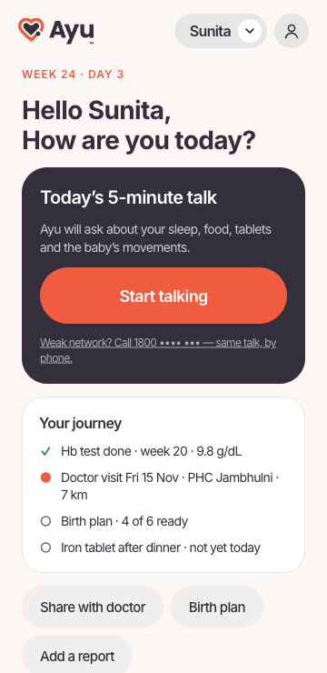 | 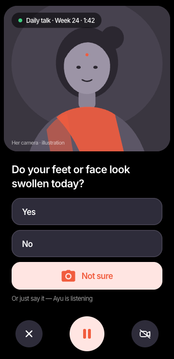 | 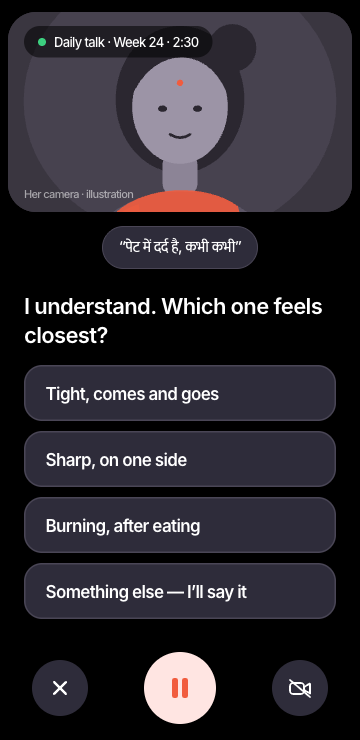 | 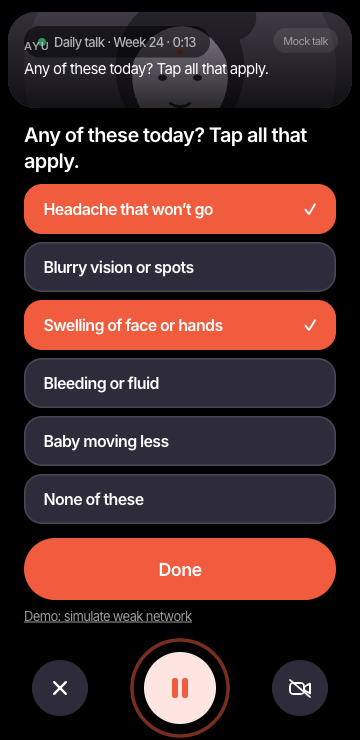 | 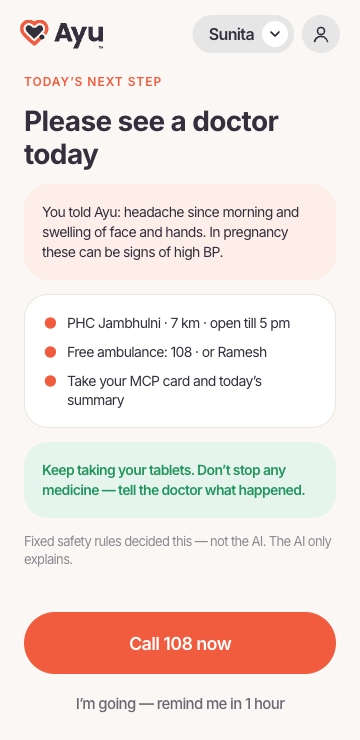 |
| **Weak network → call (S7)** | **Phone-call mode (S8)** | **Pick the picture** | **Birth & travel plan (S12)** | **Share with doctor (S13)** |
| 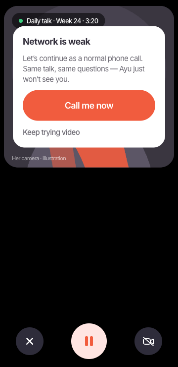 | 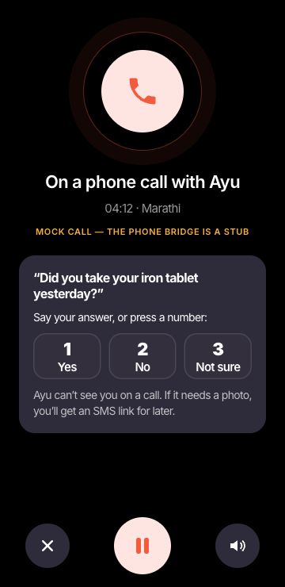 | 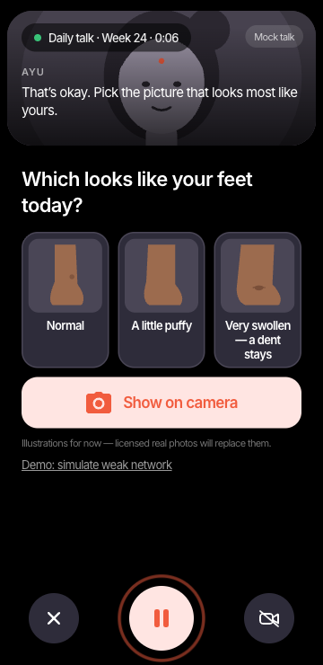 | 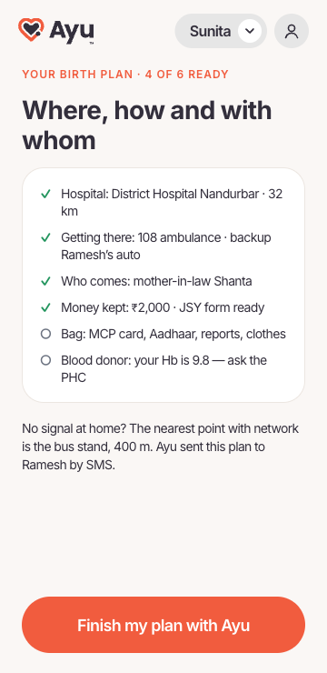 | 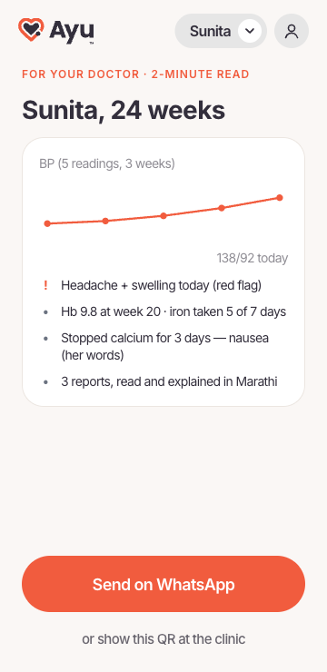 |

More in [`docs/screenshots/`](docs/screenshots) (all taken at 360 px wide), including Hindi (`hi-*`), the flows (`flow-*`), the ASHA screen and `/call-test`.

## Run it

Needs Node 20+ and [pnpm](https://pnpm.io).

```bash
pnpm i && pnpm dev
```

- Web app: http://localhost:5173 (on a desktop browser you get the phone in the middle, the screen list on the left and the design note on the right).
- Token server: http://localhost:8787 (`/api/health`, `/api/live-token`).
- Without `GEMINI_API_KEY` everything runs in **mock mode**: a scripted Ayu emits exactly the same events (captions, tool calls, cards, referral) as the real model.

Other scripts: `pnpm test` (red-flag rules), `pnpm build`, `pnpm start` (serve `dist/` + API in production), `pnpm icons`, `pnpm scan` (gitleaks).

### Demo paths

| Route | What |
|---|---|
| `#/` → `#/otp` → `#/today` | S1 phone number → S2 OTP (**any 6 digits work**) → S3 today |
| `#/talk` | The full talk: Gemini Live if the server has a key, otherwise the mock. Add `?mode=mock` to force mock. |
| `#/talk?demo=yesno` · `followup` · `danger` · `weak` | S4–S7 as in Figma, clickable through to S10 / S11 |
| `#/phone` · `#/photo` · `#/next` · `#/fine` · `#/plan` · `#/share` | S8 · S9 · S10 · S11 · S12 · S13 |
| `#/flows/a/1` · `#/flows/b/1` · `#/flows/c/1` | Flow A (week 9, Meera) · Flow B (week 34, Reena) · Flow C (day 5 after birth, Anita) |
| `#/asha` | The one ASHA screen: “3 things to check” |
| `#/call-test` | Connect, talk, and watch the transcript, tool calls and the fixed-rule referral |
| `#/screens` | Index of everything |

Tap the name pill (“Sunita”) to switch persona (Sunita, Meera, Reena, Anita) or language (English / हिंदी).

## Install it on a phone

- **Android (Chrome):** open the Pages link → tap **Add** on the “Add Ayu to your home screen” banner (or ⋮ → *Install app*). It opens full-screen and works offline: the app shell and all mock data are cached by the service worker.
- **iPhone (Safari):** Share → *Add to Home Screen*.

## Gemini Live setup

1. Get a key in [Google AI Studio](https://aistudio.google.com/apikey).
2. `cp .env.example .env` and set `GEMINI_API_KEY=…` (never commit `.env`; it is git-ignored).
3. `pnpm dev`, open `#/call-test`, pick a persona and press **Connect and talk**. Allow the microphone (and the camera if you want Ayu to see).

What was checked against Google’s docs on 12 Nov 2026 ([Live API](https://aistudio.google.com/docs/live-api), [ephemeral tokens](https://aistudio.google.com/docs/live-api/ephemeral-tokens), [tools](https://aistudio.google.com/docs/live-api/tools)):

| | |
|---|---|
| Model | `gemini-3.8-live` (override with `GEMINI_LIVE_MODEL`) |
| API version | `v1beta` (the SDK still warns that ephemeral tokens are `v1alpha`-only; `v1beta` worked in our test) |
| Mic in | 16-bit PCM, 16 kHz, mono, little-endian — `audio/pcm;rate=16000` |
| Audio out | 16-bit PCM, 24 kHz |
| Camera | JPEG frames, at most 1 per second |
| Transcripts | `inputAudioTranscription` + `outputAudioTranscription` |
| Tools | function calling; the card tools are `NON_BLOCKING` so the voice keeps going (`LIVE_ASYNC_TOOLS=false` for models without async tools) |

Smoke-tested on 12 Nov 2026: token from our server → `gemini-3.8-live` → audio + captions → `record_symptom` → `red_flag_check` fired the fixed “headache + face swelling” rule → `see_today`.

### Why the key never reaches the phone

The browser never sees `GEMINI_API_KEY`. It asks our server for a **one-use ephemeral token** (`POST /api/live-token`). The server creates it with `authTokens.create`, valid for one session started within 60 s and lasting at most 15 min, and **locks the model, system prompt and tools into the token** (`liveConnectConstraints`), so a client cannot change what Ayu is told. The endpoint is rate-limited, and CORS is open only to `ALLOWED_ORIGINS`.

## Architecture

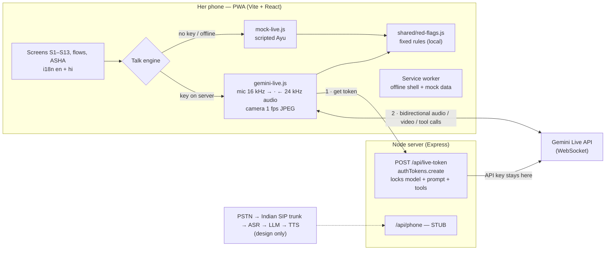

### How a question card works

1. Ayu (the model) asks out loud and calls `ask_yes_no`, `ask_single_choice`, `ask_multi_choice` or `ask_photo`.
2. The browser runs the tool locally (`shared/talk-state.js`), shows the card and answers the call silently, so Ayu keeps talking.
3. She taps or just speaks. A tap is sent back to the model as text (`[She tapped …]`).
4. `record_symptom` saves what she said in her own words. `red_flag_check` runs the **fixed rules** and returns the level Ayu must follow. Danger signs she taps go to the rules directly, without passing through the model.
5. `finish_talk` ends the talk. The app shows S10 (see someone today / call 108) or S11 (all fine) based on the rules.

`ask_single_choice` and the not-sure answer can use a `picture_set` (`feet_swelling`, `baby_skin_colour`, `stool_colour`, `medicine_strip`), so she can pick the picture that looks like hers.

## Safety rules in code

- **Fixed red-flag rules decide referrals, never the model** ([`shared/red-flags.js`](shared/red-flags.js), tested in [`test/red-flags.test.js`](test/red-flags.test.js)). The model can **add** a referral (`add_referral`) and can never lower one: `escalate()` takes the higher level.
- **Never tell her to stop a medicine.** This is in the system prompt and in every next-step screen. `/call-test` also flags any caption that sounds like “stop the tablet”.
- **Never diagnose.** The prompt asks Ayu to say “this can be a sign of …, a check today will tell”.
- **Photos only of** medicine strips, face-free skin, feet or documents. Never her face or private body parts.
- Only counts by village leave her phone. On the ASHA screen this is mock data.

The rules are a demo set based on the danger signs on India’s MCP card. **A clinician must review them before any real use.**

## Phone-call fallback (stub)

For weak networks the talk continues as a normal phone call: PSTN → an Indian SIP trunk → streaming speech recognition (for example Sarvam at 8 kHz) → LLM with the same tools and rules → TTS, hosted in India. The answers come by voice or keypad 1/2/3, and a photo request becomes an SMS link. The interface is in [`server/phone/bridge.js`](server/phone/bridge.js) and the design in [`server/phone/README.md`](server/phone/README.md). **Only the UI (S7, S8) is built; the bridge returns 501.**

## Project layout

```
shared/            used by server and browser
  red-flags.js     fixed rules (+ stop-medicine phrase check)
  live-config.js   model id, system prompt, tool declarations
  talk-state.js    local tool handlers, referral state
  personas.js      mock personas (Sunita, Meera, Reena, Anita)
server/            Express: token minting, static hosting, phone stub
src/live/          audio capture/playback, Gemini engine, mock engine
src/screens/       S1–S13, flows, ASHA, /call-test, index
src/i18n/          en.js + hi.js (every UI string)
docs/screenshots/  screenshots at 360 px
```

## Deploy

- **GitHub Pages (static, mock mode)** is deployed by [`.github/workflows/pages.yml`](.github/workflows/pages.yml) on every push to `main`. With no server, the app stays in mock mode.
- **Token server (live mode)** needs its own host, because GitHub Pages can only serve static files. Run `pnpm build && pnpm start` on any Node host (Cloud Run in `asia-south1` Mumbai, Render, Railway, Fly.io) with `GEMINI_API_KEY` and `ALLOWED_ORIGINS=https://gamingflexer.github.io` set. Then set the repository variable `LIVE_SERVER_URL` to that host’s URL and re-run the Pages workflow. The same server can also serve the PWA itself.

## UNICEF FemTech research

- Figma design (source of truth for the screens): [UNICEF FEMTech innovation → “Her daily 5-min consult”](https://www.figma.com/design/ZzHDfsxwIWGvTfXwmc27MH/UNICEF-FEMTech-innovation?node-id=37-1598)
- The flows come from stories on the research board: Flow A from stories 14 and 16, Flow B from stories 08 and 05, Flow C from stories 22 and 18/20.
- The screens here are mocks made by Claude, not designer frames. When the Figma page changes, the screens here should be updated to match.

## Credits and notes

- **Brand:** the heart + “Ayu” + ™ mark belongs to Ayu.
- **Font:** [Inter](https://rsms.me/inter/) (SIL Open Font License), one self-hosted variable woff2 file (Latin subset). Hindi text uses the phone’s own Devanagari font.
- **Pictures:** the woman on the call screens and the pick-the-picture tiles are illustrations; no real person is shown. Licensed real photos (medicine strip, skin, swelling, stool colours) will replace the tiles, each with a credit here.
- **Hindi:** a draft translation that needs review by a native speaker. Reviewer notes are in English only.
- **Licence:** none yet, so all rights are reserved by default. Ask before reusing the code.
