# Ayu — her daily 5-minute talk

An installable web app (PWA) in which a pregnant woman or new mother has a **5-minute health talk with Ayu every day**. Ayu asks doctor-style questions, shows tap-to-answer cards while it talks, falls back to an ordinary phone call when the network is weak, and turns the talks into her journey: tests, medicines, a birth and travel plan, and a 2-minute summary for her doctor.

This repo is an **open-source (MIT) public demo for research (UNICEF FemTech challenge)**. It contains the 13 core screens, 3 sample flows and the ASHA screen from our Figma design, plus **working code for a live voice/video talk through the Google Gemini Live API**.

> **Mock data only — no real patients.** Every name, number, village and reading is made up. The rules and wording have not been clinically reviewed; this is not a medical device and must not be used for care.

**Live demo (mock mode):** https://gamingflexer.github.io/ayu-daily-talk/ · [all screens and flows](https://gamingflexer.github.io/ayu-daily-talk/#/screens) · [call test](https://gamingflexer.github.io/ayu-daily-talk/#/call-test)

| Today (S3) | Yes / no + camera (S4) | Doctor-style follow-up (S5) | Danger signs (S6) | See someone today (S10) |
|---|---|---|---|---|
| 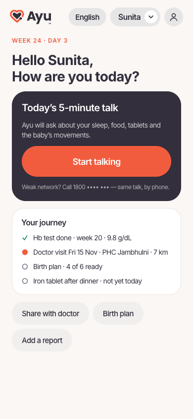 | 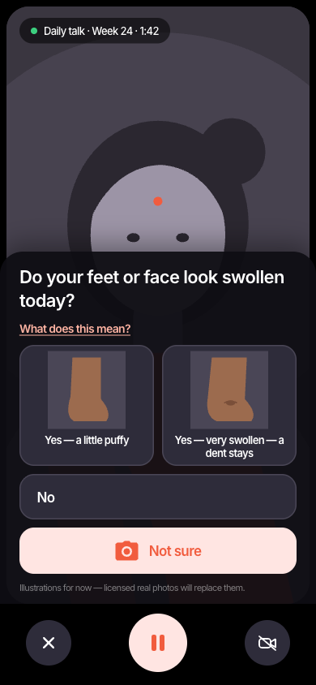 | 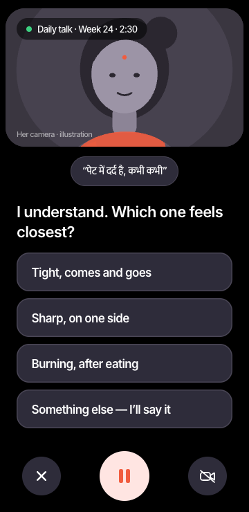 | 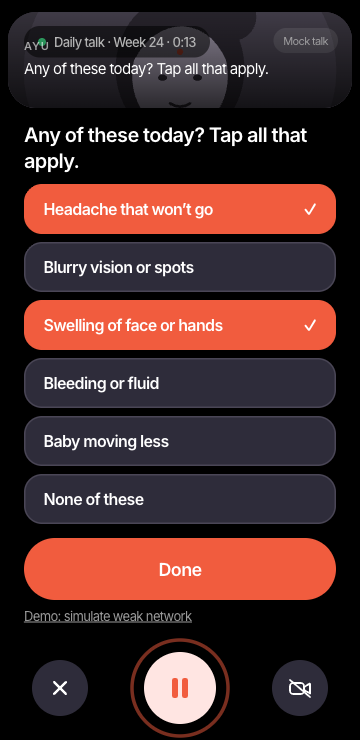 | 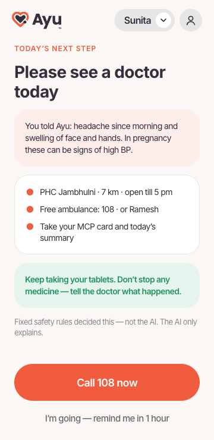 |
| **Weak network → call (S7)** | **Phone-call mode (S8)** | **Pick the picture** | **Birth & travel plan (S12)** | **Share with doctor (S13)** |
| 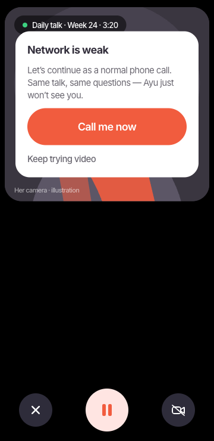 | 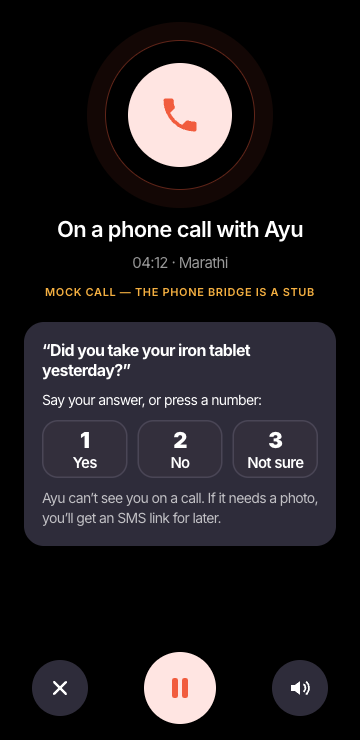 | 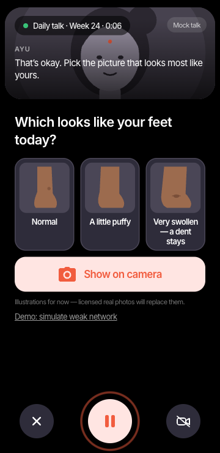 | 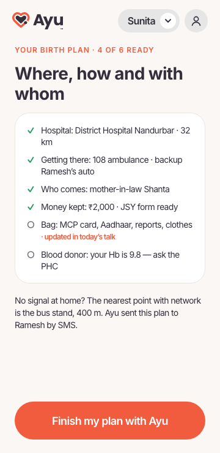 | 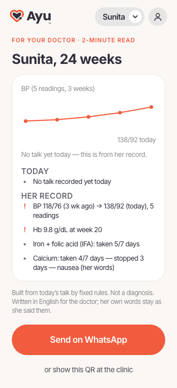 |

| **Her camera on talk start** | **Ayu is thinking** | **Severity with definitions** | **Body map** | **Marathi talk** |
|---|---|---|---|---|
| 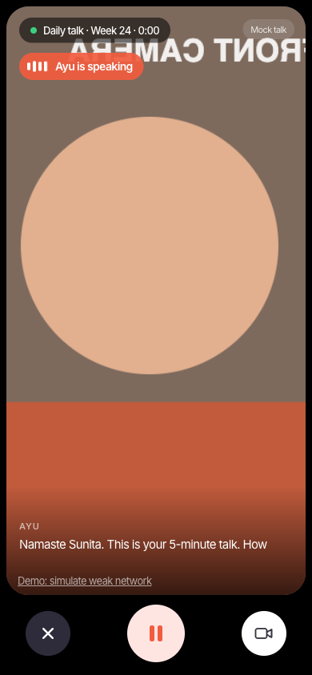 | 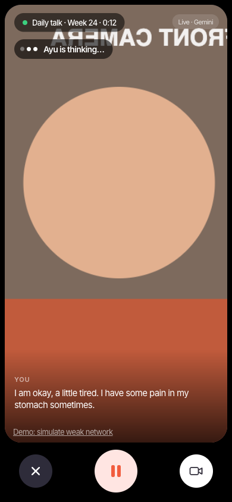 | 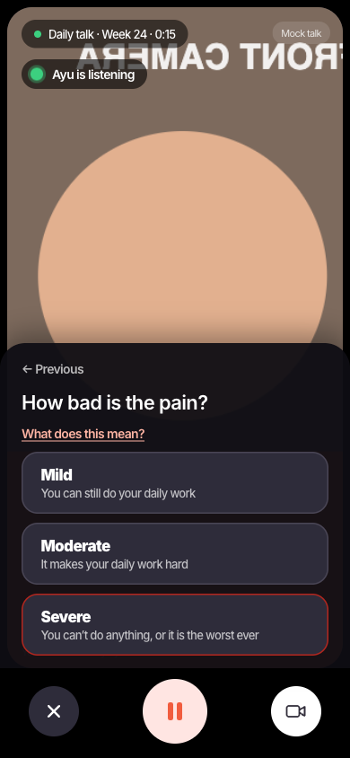 | 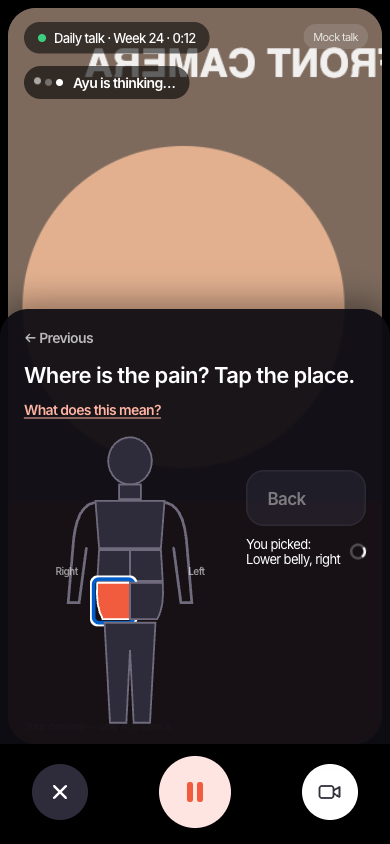 | 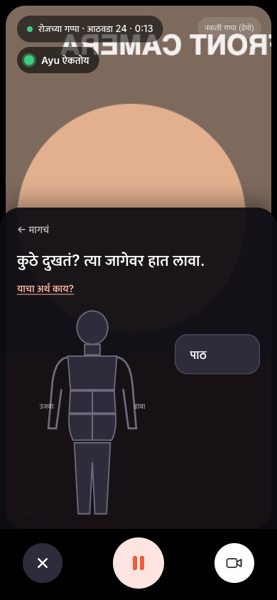 |

More in [`docs/screenshots/`](docs/screenshots), including Hindi (`hi-*`), Marathi (`mr-*`), every talk state (`talk-state-*`), every card type (`talk-card-*`), live Gemini runs (`live-*`, `en3-live-*`, `mr-live-*`), the flows (`flow-*`), the ASHA screen and `/call-test`. Screenshots from 13 Nov on are 390 px wide.

## Run it

Needs Node 20+ and [pnpm](https://pnpm.io).

```bash
pnpm i && pnpm dev
```

- Web app: http://localhost:5173 (on a desktop browser you get the phone in the middle, the screen list on the left and the design note on the right).
- Token server: http://localhost:8787 (`/api/health`, `/api/live-token`).
- Without `GEMINI_API_KEY` everything runs in **mock mode**: a scripted Ayu emits exactly the same events (captions, tool calls, cards, referral) as the real model.

Other scripts: `pnpm test` (red-flag rules, talk-state tools, doctor summary, server guards), `pnpm build`, `pnpm start` (serve `dist/` + API in production), `pnpm icons`, `pnpm scan` (gitleaks).

### Two one-tap demos

The top of S1 and Today has **Try a demo:** with two mock cases; one tap starts that talk (mic + camera asked inside the tap).

1. **Pregnant, week 34** (Reena; the default). Ayu asks “Do your feet or face look like this today?” with picture answers (Yes — puffy feet / Yes — a dent stays when pressed / No / Not sure → camera). Puffy feet + a headache that won’t go → the fixed pair rule → S10 “Please see a doctor today” with the nearest facility and free ambulance 108 (Flow B).
2. **Grandma on a new sugar tablet** (Shanti, 68, not pregnant). Ayu already knows she started metformin 5 days ago; the call shows “Ayu knows: new sugar tablet (metformin) since 5 days”. Ayu asks “How is your stomach since the new tablet?” with icon answers (A little upset, loose motion / Vomiting, can’t keep food down / No problem). A little upset → all fine, with “Normal in the first weeks. Take it with food and keep taking it…”. Vomiting, dehydration (very thirsty, dizzy, little urine) or strong belly pain → see someone today. Pregnancy and newborn rules never apply to her (`stage: 'elder'` in `shared/red-flags.js`), and Ayu never tells her to stop the tablet.

### Demo paths

| Route | What |
|---|---|
| `#/` → `#/otp` → `#/today` | S1 phone number → S2 OTP (**any 6 digits work**) → S3 today |
| `#/talk` | The full talk: Gemini Live if the server has a key, otherwise the mock. Add `?mode=mock` to force mock. |
| `#/talk?demo=yesno` · `followup` · `body` · `duration` · `severity` · `search` · `danger` · `weak` | S4–S7 and the answer types, clickable through to S10 / S11 |
| `#/talk?mode=mock&drop=1` | A mock talk whose connection drops and comes back (the reconnecting state) |
| `#/talk?mode=mock&net=weak` | A real (mock) talk that drops to S7 → S8 and keeps what she said |
| `#/phone` · `#/photo` · `#/next` · `#/fine` · `#/plan` · `#/share` | S8 · S9 · S10 · S11 · S12 · S13 |
| `#/flows/a/1` · `#/flows/b/1` · `#/flows/c/1` | Flow A (week 9, Meera) · Flow B (week 34, Reena) · Flow C (day 5 after birth, Anita) |
| `#/asha` | The one ASHA screen: “3 things to check” |
| `#/call-test` | Connect, talk, and watch the transcript, tool calls and the fixed-rule referral |
| `#/screens` | Index of everything |

Tap the name pill (“Sunita”) or the language pill next to it to switch persona (Sunita, Meera, Reena, Anita) or language. S1 has the language chips too.

**Languages:** English, हिंदी, मराठी, বাংলা, தமிழ், తెలుగు, ಕನ್ನಡ, ગુજરાતી, മലയാളം — every UI string, the mock Ayu's lines, and Gemini's speech and card text (in that language's own script). **All non-English text is a draft translation for native review.** `pnpm test` checks that every language has every key (`test/i18n.test.js`); `node scripts/check-lang.mjs mr` lists what one language is missing.

## Install it on a phone

- **Android (Chrome):** open the Pages link → tap **Add** on the “Add Ayu to your home screen” banner (or ⋮ → *Install app*). It opens full-screen and works offline: the app shell and all mock data are cached by the service worker.
- **iPhone (Safari):** Share → *Add to Home Screen*.

## Gemini Live setup

1. Get a key in [Google AI Studio](https://aistudio.google.com/apikey).
2. `cp .env.example .env` and set `GEMINI_API_KEY=…` (never commit `.env`; it is git-ignored).
3. `pnpm dev`, open `#/call-test`, pick a persona and press **Connect and talk**. Allow the microphone (and the camera if you want Ayu to see).

What was checked against Google’s docs on 12 Nov 2026 ([Live API](https://aistudio.google.com/docs/live-api), [ephemeral tokens](https://aistudio.google.com/docs/live-api/ephemeral-tokens), [tools](https://aistudio.google.com/docs/live-api/tools)):

| | |
|---|---|
| Model | `gemini-3.8-live` (override with `GEMINI_LIVE_MODEL`) |
| API version | `v1beta` (the SDK still warns that ephemeral tokens are `v1alpha`-only; `v1beta` worked in our test) |
| Mic in | 16-bit PCM, 16 kHz, mono, little-endian — `audio/pcm;rate=16000` |
| Audio out | 16-bit PCM, 24 kHz |
| Camera | JPEG frames, at most 1 per second |
| Transcripts | `inputAudioTranscription` + `outputAudioTranscription` |
| Tools | function calling; the card tools are `NON_BLOCKING` so the voice keeps going (`LIVE_ASYNC_TOOLS=false` for models without async tools) |

Checked end to end on 13 Nov 2026 in headless Chrome (fake mic from recorded speech, fake camera): picture card → “Not sure” camera turn → the model describes what it sees → danger card → fixed rule → `finish_talk` → S10, in English and Hindi. Screenshots: `docs/screenshots/live-gemini-*.png`.

Smoke-tested on 12 Nov 2026: token from our server → `gemini-3.8-live` → audio + captions → `record_symptom` → `red_flag_check` fired the fixed “headache + face swelling” rule → `see_today`.

### Why the key never reaches the phone

The browser never sees `GEMINI_API_KEY`. It asks our server for a **one-use ephemeral token** (`POST /api/live-token`). The server creates it with `authTokens.create`, valid for one session started within 60 s and lasting at most 15 min, and **locks the model, system prompt and tools into the token** (`liveConnectConstraints`), so a client cannot change what Ayu is told. The endpoint is rate-limited, and CORS is open only to `ALLOWED_ORIGINS`.

## Architecture

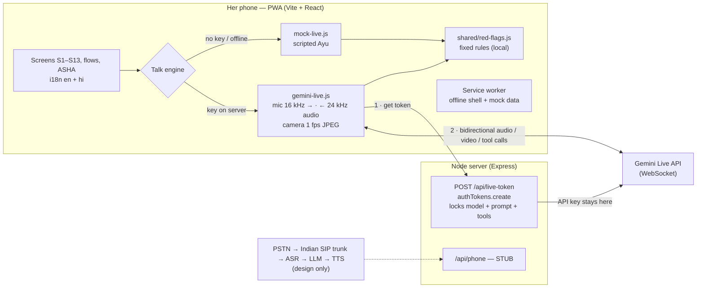

### Starting the talk: mic + her camera, one prompt

The talk starts from her tap (“Start talking” on Today, or “Start today’s talk” on a talk opened directly), because iOS Safari only allows `getUserMedia` inside a user gesture. That one tap asks for the microphone **and the front camera** together (`src/live/media.js`); her live video fills the tile (only her, zoomed in), and frames go to the model at ≤1 fps only while a camera is on. If she refuses the camera or has none, the talk goes on voice-only with “Camera off — Ayu can only hear you” and a button to try again. A card that needs a look (a picture set, “Show on camera”, “Not sure”) switches to the back camera by itself and back to the front afterwards; `ask_photo` opens the photo screen by itself. If the browser blocks that (no gesture, permission withdrawn), the tile shows one big “Tap to turn on camera” button. The woman illustration is only on the static screens map, labelled “Illustration”.

### Talk states

The state chip on the video always says what is happening (`src/live/phase.js`, from engine events only): getting ready (permissions) → connecting → **Ayu is speaking** (bars follow her voice) ⇄ **Ayu is listening** (a ring follows the mic) → **Ayu is thinking…** (after her words stop or she taps, until the first reply audio or card) → **Checking with the safety rules…** (red_flag_check) → **Saving today’s talk…**, plus reconnecting (the socket dropped; the Gemini engine gets a new token and resumes twice at most), paused, ended and an error with “Start again”. The tapped answer keeps a spinner until Ayu replies. Other waits have their own state: OTP check (S2), “Getting today ready…” (S3), calling (S8), camera starting / reading / sending (S9), and the doctor note skeleton (S13).

### How a question card works

1. Ayu (the model) asks out loud and calls a card tool: `ask_yes_no`, `ask_single_choice`, `ask_multi_choice`, `ask_duration` (since-when chips), `ask_severity` (mild / moderate / severe with a one-line definition each), `ask_body_map` (tap the area on a simple outline), `ask_symptom_search` (type-ahead over a fixed local symptom list in her language) or `ask_photo`. Every card has “What does this mean?” (an explanation the model sends with the card) and “← Previous” to change the last answer (the model is told; the signs that answer gave are re-derived). Greetings, open questions and confirming what she said are voice only. A talk is many short questions (10–40), one card at a time; if Ayu asks a closed question aloud and no card comes within 3.5 s, the app nudges the model once to show it (`card-missing` in the log).
2. The browser runs the tool locally (`shared/talk-state.js`), shows the card and answers the call silently, so Ayu keeps talking.
3. She taps or just speaks. A tap is sent back to the model as text (`[She tapped …]`).
4. `record_symptom` saves what she said in her own words. `red_flag_check` runs the **fixed rules** and returns the level Ayu must follow. Danger signs she taps go to the rules directly, without passing through the model.
5. `finish_talk` ends the talk. The app shows S10 (see someone today / call 108) or S11 (all fine) based on the rules.

**“Not sure” is a camera button** (UI rule 1). Tapping it turns the talk into a camera turn: her back camera streams JPEG frames (≤1 fps) to the model with a cue to say in one or two sentences what it sees (never a diagnosis; feet, face-free skin, a medicine strip or a document only), then she confirms or picks a picture. The mock engine plays the same turn with a scripted line.

`update_plan` saves birth/travel-plan items from the talk (S12 shows them as “updated in today’s talk”). When the talk ends (`finish_talk`, ✕, a dropped socket or the 5-minute limit), the app saves a snapshot of the talk; S10 / S11 / S13 read only that snapshot.

**S13 doctor summary** ([`shared/doctor-summary.js`](shared/doctor-summary.js)) is deterministic: the fixed-rule result, the danger signs, her own words, the card answers, what she showed on camera, her BP/Hb/adherence and plan changes, in English for the doctor. If the server has a key, `/api/summary` adds a ≤60-word note written by a small text model from the same facts; the note may not state the referral level, and a note that sounds routine while the rules say “see today” is dropped.

**Weak network → S7 → S8:** `navigator.connection` (2G, RTT > 1.5 s, downlink < 0.15 Mbps), the `offline` event, two slow health pings (live mode) or the Live socket dropping before the talk is done. S8 keypad answers go through the same talk state and fixed rules, so a talk that started on video carries on by phone.

`ask_single_choice` and yes/no cards can use a `picture_set` (`feet_swelling`, `baby_skin_colour`, `stool_colour`, `medicine_strip`), so she can pick the picture that looks like hers.

## Safety rules in code

- **Fixed red-flag rules decide referrals, never the model** ([`shared/red-flags.js`](shared/red-flags.js), tested in [`test/red-flags.test.js`](test/red-flags.test.js)). The model can **add** a referral (`add_referral`) and can never lower one: `escalate()` takes the higher level.
- **Never tell her to stop a medicine.** This is in the system prompt and in every next-step screen. `/call-test` also flags any caption that sounds like “stop the tablet”.
- **Never diagnose.** The prompt asks Ayu to say “this can be a sign of …, a check today will tell”.
- **Photos only of** medicine strips, face-free skin, feet or documents. Never her face or private body parts.
- Only counts by village leave her phone. On the ASHA screen this is mock data.

The rules are a demo set based on the danger signs on India’s MCP card. **A clinician must review them before any real use.**

## Phone-call fallback (stub)

For weak networks the talk continues as a normal phone call: PSTN → an Indian SIP trunk → streaming speech recognition (for example Sarvam at 8 kHz) → LLM with the same tools and rules → TTS, hosted in India. The answers come by voice or keypad 1/2/3, and a photo request becomes an SMS link. The interface is in [`server/phone/bridge.js`](server/phone/bridge.js) and the design in [`server/phone/README.md`](server/phone/README.md). **Only the UI (S7, S8) is built; the bridge returns 501.**

## Project layout

```
shared/            used by server and browser
  red-flags.js     fixed rules (+ stop-medicine phrase check)
  live-config.js   model id, system prompt, tool declarations
  talk-state.js    local tool handlers, referral state
  personas.js      mock personas (Sunita, Meera, Reena, Anita)
  doctor-summary.js  the 2-minute summary for the doctor (S13)
server/            Express: static hosting, phone stub
  lib/             API handlers + guards shared with the Vercel functions
api/               Vercel functions (health, live-token, summary)
src/live/          audio capture/playback, Gemini engine, mock engine
src/screens/       S1–S13, flows, ASHA, /call-test, index
src/i18n/          en, hi, mr, bn, ta, te, kn, gu, ml (every UI string; keys.js = parity rule)
docs/screenshots/  screenshots at 360 px
docs/GAPS.md       what is built vs Figma, and what is still mock
```

## Deploy

### Vercel (PWA + token server as functions)

`vercel.json` builds the PWA (`pnpm build` → `dist/`) and serves `api/health.js`, `api/live-token.js` and `api/summary.js` as Node functions in `bom1` (Mumbai). They share `server/lib/api.js` with the Express server, so both enforce the same rules:

| Env var | Default | |
|---|---|---|
| `GEMINI_API_KEY` | — | required for live mode; never sent to the browser |
| `ALLOWED_ORIGINS` | — | comma list of browser origins allowed to call the POST endpoints. The API's own host is always allowed. Requests **without** an `Origin` header (the React Native app, curl) are allowed and go through the same rate limit and cap. Any other origin gets 403. |
| `LIVE_TOKEN_DAILY_CAP` | 200 | tokens per UTC day |
| `LIVE_TOKEN_PER_MIN` | 6 | tokens per IP per minute |
| `SUMMARY_MODEL` | `gemini-flash-lite-latest` | S13 note |
| `SUMMARY_DAILY_CAP` / `SUMMARY_PER_MIN` | 300 / 10 | |
| `GEMINI_LIVE_MODEL`, `LIVE_ASYNC_TOOLS` | `gemini-3.8-live`, true | |

**Limitation:** the rate limit and the daily cap are kept in memory per function instance (a cold start resets them; several warm instances each have their own count). Fine for a demo; use a shared store (e.g. Upstash Redis) before real traffic.

### Others

- **GitHub Pages (static, mock mode)** is deployed by [`.github/workflows/pages.yml`](.github/workflows/pages.yml) on every push to `main`. With no server, the app stays in mock mode.
- **Token server (live mode)** needs its own host, because GitHub Pages can only serve static files. Run `pnpm build && pnpm start` on any Node host (Cloud Run in `asia-south1` Mumbai, Render, Railway, Fly.io) with `GEMINI_API_KEY` and `ALLOWED_ORIGINS=https://gamingflexer.github.io` set. Then set the repository variable `LIVE_SERVER_URL` to that host’s URL and re-run the Pages workflow. The same server can also serve the PWA itself.

## UNICEF FemTech research

- Figma design (source of truth for the screens): [UNICEF FEMTech innovation → “Her daily 5-min consult”](https://www.figma.com/design/ZzHDfsxwIWGvTfXwmc27MH/UNICEF-FEMTech-innovation?node-id=37-1598)
- The flows come from stories on the research board: Flow A from stories 14 and 16, Flow B from stories 08 and 05, Flow C from stories 22 and 18/20.
- The screens here are mocks made by Claude, not designer frames. When the Figma page changes, the screens here should be updated to match.

## Credits and notes

- **Brand:** the heart + “Ayu” + ™ mark belongs to Ayu.
- **Font:** [Inter](https://rsms.me/inter/) (SIL Open Font License), one self-hosted variable woff2 file (Latin subset). Hindi text uses the phone’s own Devanagari font.
- **Pictures:** the woman on the call screens and the pick-the-picture tiles are illustrations; no real person is shown. Licensed real photos (medicine strip, skin, swelling, stool colours) will replace the tiles, each with a credit here.
- **Translations:** Hindi, Marathi, Bengali, Tamil, Telugu, Kannada, Gujarati and Malayalam are draft translations that need review by a native speaker. Reviewer notes (design notes, the screens index, `/call-test`, flow captions) are in English only.
- **Licence:** the code is open source under the [MIT licence](LICENSE). The Ayu name and the heart + “Ayu” + ™ mark are not covered by it and stay trademarks of Ayu.
