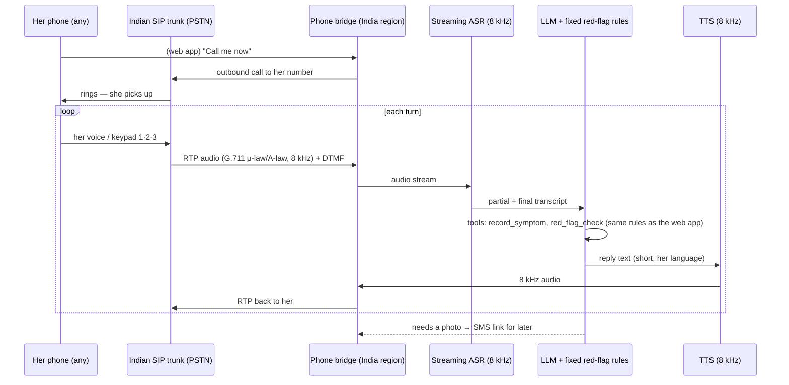

# Phone-call fallback — design (stub)

> **Status: stub.** The interface is in [`bridge.js`](bridge.js) and every route returns `501`. The phone screen in the app (S8) is a mock.

## Why
About half the women this is for live where mobile data drops to one bar. A video talk needs ~1.7 Mbps and an audio-only data call ~100 kbps. An ordinary phone call needs **no data** and works on 2G and keypad phones. So when the network is weak, Ayu continues the same talk as a normal call.

## Flow

## Pieces and options

| Piece | Options | Notes |
|---|---|---|
| Telephony | An Indian SIP trunk / cloud telephony provider with a DoT-compliant number | Outbound calls to Indian mobiles need an Indian provider and a registered caller ID. |
| Media bridge | LiveKit SIP, Jambonz, FreeSWITCH/Asterisk | Converts RTP ↔ PCM, carries DTMF, handles barge-in. |
| Speech → text | Sarvam (speech recognition built for 8 kHz phone audio in Indian languages), or Google STT | Gemini Live has had Hindi detection issues in search reports; test first. |
| LLM | Same prompt and tools as the web talk (`shared/live-config.js`), or OpenAI Realtime over SIP as a single-vendor option | Tools stay local: `red_flag_check` runs `shared/red-flags.js`. |
| Text → speech | Sarvam (8 kHz voices), or Google TTS | Short sentences; speak the 1/2/3 options. |
| Hosting | An India region (e.g. Mumbai) | US-hosted voice AI adds about 1 s per turn. |

## Rules that do not change on a call
- Every question keeps **1 · Yes, 2 · No, 3 · Not sure** (or 1/2/3 options) on the keypad, because dialects still trip speech recognition.
- Fixed red-flag rules decide referrals; the model may add one, never remove one.
- Never tell her to stop a medicine.
- Ayu can't see her on a call: a photo request becomes an SMS link she can open later on Wi-Fi or better signal.
- What she says on the call lands in the same journey as the web talk.

## Interface (from `bridge.js`)
- `startCall({ phone, persona, lang }) → { callId }`
- `endCall(callId)`
- `onDtmf(callId, digit)` — `1`, `2`, `3`, `9` repeat, `0` a person
- `requestPhotoBySms(callId, purpose) → { smsSent }`
